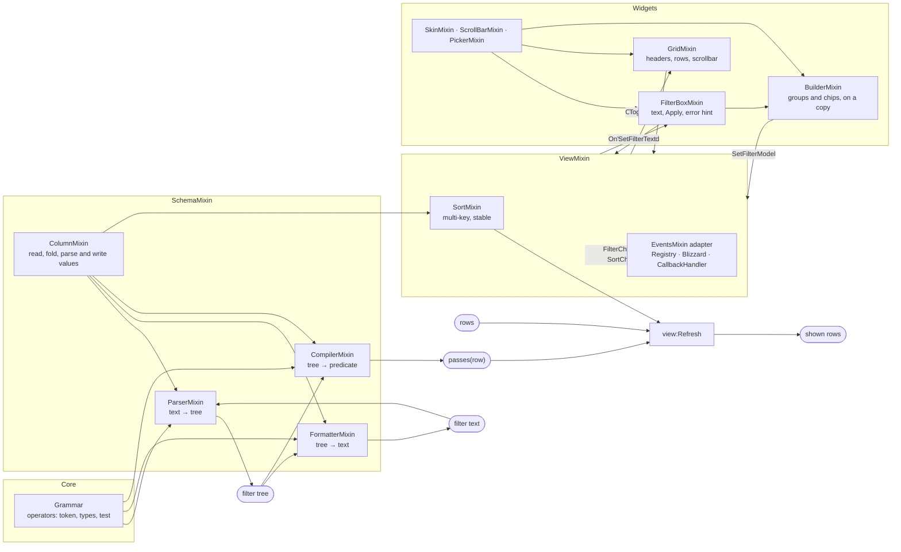

# How it fits together

Each part is a mixin in its own file under `Mixins\`; `lib:NewSchema(defs, ...)`
and `schema:NewView(...)` put the caller's mixins over the library's, so any
method can be replaced. The operators live in one table (`Core\Grammar.lua`):
the parser, the formatter, the compiler and later the Builder all read it, so an
operator cannot exist in one and not in another.

## Widgets

The widgets are frames with a mixin over them, made by `DG:CreateFilterBox`,
`DG:CreateGrid` and `DG:CreateBuilder`, each taking a skin and the caller's
mixins. They are built from plain frames (a Slider for the scrollbar, buttons
for the pickers) rather than ScrollBox, TableBuilder or the game's dropdowns,
which differ between Classic Era and Forever or are missing from Era. A view
keeps a list of its widgets (`AddWidget`) and calls `OnViewChanged(event)` on
each before the events adapter: the adapter is the addon's to choose, and some
adapters give no way to listen at all.

A list (the grid's rows, the pick list, the Builder's lines) has a fixed number
of line frames and fills them from the scrollbar's offset, so scrolling makes no
frames and no tables. The Builder walks the filter tree recursively into a list
of entries (group, condition, add line, each with its depth) and draws the
entries from the offset; every change edits the tree in place and draws again.

## Patterns

- **Mixin** for composition, with Blizzard's own `Mixin` and `CreateFromMixins`
  (both clients have them in `Blizzard_SharedXMLBase`). `SchemaMixin` is the
  parser, formatter and compiler mixins together; `ViewMixin` is the events
  and sort mixins plus its own methods.
- **Strategy**: each operator carries its test. A negative operator is its
  opposite's test turned round, so a blank value, which fails every test,
  passes the negative ones.
- **Composite**: a filter is a tree of groups (`children`) and conditions; the
  only tag is whether a node has `children`.
- **Interpreter**: the parser reads text into the tree by recursive descent (OR
  binds loosest, then AND, then NOT; brackets keep the group they make), and
  the compiler turns the tree into one closure, built once per filter, so a
  refresh parses nothing and builds no tables.
- **Observer** with **adapters**: the view only calls `InitEvents` and
  `Notify(event)`; the adapter decides where the event goes. Lua has no
  interfaces, so the contract is a base mixin, `EventsMixin`, that every
  adapter is made from (`---@class X: LibDataGridEventsMixin` for the language
  server). Its methods do nothing, which also makes it the null object: a view
  made with it alone sends no events.

## Loading

`LibDataGrid-1.0.lua` registers the library with LibStub and sets
`lib.pending`; every other file returns at once unless it is set, and
`ViewMixin.lua`, the last in `lib.xml`, clears it. A copy LibStub turned away
(the same or an older MINOR) so changes nothing.

## Filter text and the tree

The formatter writes what the parser reads: a nested group of more than one is
bracketed, a group of one is written as that one, conditions that are not
finished are left out, and values are quoted when the parser would not read
them bare. So `Parse(Format(tree))` gives the tree back, except that a group of
one comes back as its one child (a negated one as a negated AND group of it),
and `Format(Parse(text))` is the text in the schema's words.
